# CRUD NoSQL con MongoDB — Gestión de Estudiantes

## Descripción

Proyecto académico desarrollado para la materia **Bases de Datos Avanzadas**, cuyo objetivo es demostrar el funcionamiento de las operaciones CRUD utilizando **MongoDB Query Language (MQL)**.

Se implementa un sistema sencillo de gestión de estudiantes mediante una base de datos NoSQL orientada a documentos.

El proyecto permite:

- **CREATE:** Crear nuevos registros de estudiantes.
- **READ:** Consultar información mediante filtros y operadores.
- **UPDATE:** Modificar datos de estudiantes existentes.
- **DELETE:** Eliminar uno o varios registros.
- **VERIFICACIÓN:** Comprobar automáticamente los resultados de las operaciones.

El propósito de este repositorio es funcionar como un **tutorial práctico y reproducible**, incluyendo instrucciones de ejecución, ejemplos de código y evidencias visuales.

---

## 1. Tecnologías utilizadas

| Tecnología | Función |
|---|---|
| MongoDB Community Server | Almacenamiento de documentos |
| MongoDB Shell (`mongosh`) | Ejecución de comandos MQL |
| MongoDB Compass | Visualización y comprobación de los datos |
| Visual Studio Code | Desarrollo y ejecución de scripts |
| JavaScript | Lenguaje utilizado en los scripts |
| Windows 11 | Sistema operativo de desarrollo |
| Git y GitHub | Control de versiones y publicación del tutorial |

**Nota:** No es necesario instalar Node.js para ejecutar este proyecto. Los archivos JavaScript se ejecutan directamente mediante `mongosh`.

---

## 2. Base de datos

Para este tutorial utilizamos la siguiente configuración:

- **Base de datos:** `universidad`
- **Colección:** `estudiantes`
- **Conexión local:** `mongodb://localhost:27017`

MongoDB almacena la información en documentos con una estructura similar a JSON.

Cada estudiante contiene los siguientes campos:

| Campo | Descripción | Ejemplo |
|---|---|---|
| `matricula` | Identificador académico | `"001"` |
| `nombre` | Nombre del estudiante | `"Ana"` |
| `edad` | Edad del estudiante | `20` |
| `carrera` | Carrera universitaria | `"Sistemas"` |
| `semestre` | Semestre actual | `2` |

**Ejemplo de documento:**

```json
{
  "matricula": "001",
  "nombre": "Ana",
  "edad": 20,
  "carrera": "Sistemas",
  "semestre": 2
}
```

MongoDB también genera automáticamente un identificador único llamado `_id` para cada documento.

---

## 3. Estructura del proyecto

```text
CRUD-NoSQL-MongoDB/
│
├── 01_inicializar.js
├── 02_create.js
├── 03_read.js
├── 04_update.js
├── 05_delete.js
├── 06_verificacion.js
│
├── docs/
│   └── capturas/
│       ├── 02-create.png
│       ├── 02-create2.png
│       ├── 02-read.png
│       ├── 02-readT1.png
│       ├── 02-readT2.png
│       ├── 02-readT3.png
│       ├── 02-readT4.png
│       ├── 02-readT5.png
│       ├── 02-readT6.png
│       ├── 02-readT7.png
│       ├── 03-update-antes.png
│       ├── 03-update-despues.png
│       ├── 04-delete-antes.png
│       ├── 04-delete-despues.png
│       ├── 04-delete-terminal.png
│       └── 05-verificacion.png
│
├── .gitignore
└── README.md
```

### Descripción de los archivos

| Archivo | Operación | Función |
|---|---|---|
| `01_inicializar.js` | Inicialización | Prepara cuatro estudiantes de ejemplo |
| `02_create.js` | CREATE | Inserta documentos con `insertOne()` e `insertMany()` |
| `03_read.js` | READ | Realiza consultas, filtros, ordenamientos y proyecciones |
| `04_update.js` | UPDATE | Modifica documentos con `updateOne()` y `updateMany()` |
| `05_delete.js` | DELETE | Elimina documentos con `deleteOne()` y `deleteMany()` |
| `06_verificacion.js` | Verificación | Ejecuta nueve comprobaciones automáticas |
| `docs/capturas/` | Evidencias | Contiene las capturas de los resultados |
| `README.md` | Documentación | Explica el funcionamiento y la ejecución del proyecto |

---

## 4. Instalación y requisitos

Para ejecutar el proyecto en Windows 11 se requiere instalar:

1. [Visual Studio Code](https://code.visualstudio.com/download)
2. [MongoDB Community Server](https://www.mongodb.com/try/download/community)
3. [MongoDB Shell](https://www.mongodb.com/try/download/shell)
4. [MongoDB Compass](https://www.mongodb.com/try/download/compass)

### 4.1. Verificar MongoDB Server

MongoDB Community Server debe encontrarse instalado y funcionando como servicio de Windows.

Abrir PowerShell y ejecutar:

```powershell
Get-Service MongoDB
```

El resultado esperado es que el servicio aparezca con estado:

```text
Running
```

### 4.2. Comprobar la conexión con MongoDB

Ejecutar:

```powershell
mongosh "mongodb://localhost:27017"
```

Dentro de MongoDB Shell, escribir:

```javascript
db.runCommand({ ping: 1 })
```

**Resultado esperado:**

```javascript
{ ok: 1 }
```

Esto confirma que el servidor está respondiendo correctamente.

Para salir de MongoDB Shell:

```javascript
exit
```

### 4.3. Obtener el proyecto

El repositorio se puede descargar desde GitHub o clonar utilizando Git:

```powershell
git clone https://github.com/JJGavidia/CRUD-NoSQL-MongoDB.git
```

Después, abrir la carpeta `CRUD-NoSQL-MongoDB` en Visual Studio Code.

Todos los comandos siguientes se deben ejecutar desde la terminal integrada, ubicada en la carpeta principal del proyecto.

---

## 5. Ejecución del proyecto

Los seis archivos deben ejecutarse **en orden**, comenzando por la inicialización y terminando con la verificación automática.

### 5.1. Inicializar la base de datos

**Archivo:** `01_inicializar.js`

**Objetivo:** Preparar la colección `estudiantes` e insertar cuatro documentos iniciales.

Ejecutar:

```powershell
mongosh "mongodb://localhost:27017" --file "01_inicializar.js"
```

Se insertan los siguientes estudiantes:

| Matrícula | Nombre | Carrera | Semestre |
|---|---|---|---|
| 001 | Ana | Sistemas | 2 |
| 002 | Luis | Sistemas | 3 |
| 003 | Maria | Industrial | 4 |
| 004 | Carlos | Sistemas | 2 |

**Resultado esperado:** Cuatro documentos registrados.

**Advertencia:** Este script ejecuta `deleteMany({})` antes de insertar los estudiantes iniciales. Por lo tanto, elimina todos los documentos existentes en `universidad.estudiantes`. Debe utilizarse únicamente en la colección de práctica.

---

## 6. CREATE — Inserción de documentos

**Archivo:** `02_create.js`

CREATE permite registrar documentos nuevos dentro de una colección.

MongoDB proporciona métodos para insertar uno o varios documentos.

### 6.1. Insertar un documento con `insertOne()`

Ejemplo:

```javascript
estudiantes.insertOne({
  matricula: "005",
  nombre: "Sofia",
  edad: 20,
  carrera: "Sistemas",
  semestre: 2
});
```

Este comando inserta un documento correspondiente a Sofia.

### 6.2. Insertar varios documentos con `insertMany()`

Ejemplo:

```javascript
estudiantes.insertMany([
  {
    matricula: "006",
    nombre: "Pedro",
    edad: 23,
    carrera: "Industrial",
    semestre: 5
  },
  {
    matricula: "007",
    nombre: "Laura",
    edad: 21,
    carrera: "Sistemas",
    semestre: 3
  }
]);
```

Este comando inserta dos documentos en una sola operación.

### 6.3. Ejecutar CREATE

En la terminal de Visual Studio Code:

```powershell
mongosh "mongodb://localhost:27017" --file "02_create.js"
```

**Resultado esperado:**

- Cuatro estudiantes iniciales.
- Tres estudiantes agregados.
- **Total: siete estudiantes.**

### Evidencias de CREATE

Las siguientes capturas muestran los siete documentos registrados en MongoDB Compass.

**Vista inicial de la colección:**

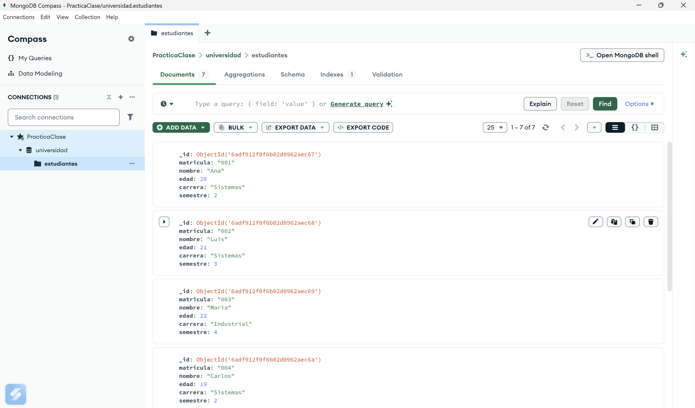

**Vista de los documentos agregados:**

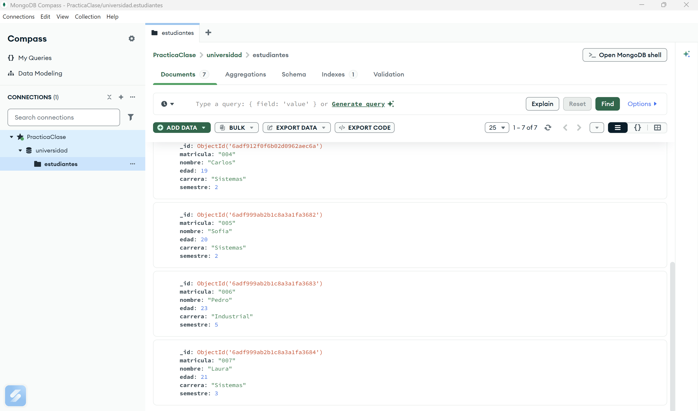

Estas imágenes permiten comprobar que las inserciones se realizaron correctamente y que la colección contiene siete documentos.

---

## 7. READ — Consulta de documentos

**Archivo:** `03_read.js`

READ permite recuperar información de una colección sin modificar los documentos almacenados.

MongoDB utiliza filtros y operadores de MQL para realizar consultas específicas.

### 7.1. Consultar todos los documentos

```javascript
estudiantes.find()
```

Devuelve todos los estudiantes registrados.

### 7.2. Buscar un documento específico

```javascript
estudiantes.findOne({
  matricula: "001"
})
```

Busca al estudiante cuya matrícula es `001`.

### 7.3. Filtrar documentos por carrera

```javascript
estudiantes.find({
  carrera: "Sistemas"
})
```

Devuelve únicamente los estudiantes de Sistemas.

**Resultado esperado:** Cinco documentos.

### 7.4. Consultar estudiantes mayores de 20 años

```javascript
estudiantes.find({
  edad: { $gt: 20 }
})
```

El operador `$gt` significa **mayor que**.

### 7.5. Utilizar condiciones múltiples

```javascript
estudiantes.find({
  $and: [
    { carrera: "Sistemas" },
    { edad: { $gte: 20 } }
  ]
})
```

El operador `$and` exige que se cumplan ambas condiciones.

El operador `$gte` significa **mayor o igual que**.

### 7.6. Consultar mediante `$or`

```javascript
estudiantes.find({
  $or: [
    { carrera: "Sistemas" },
    { carrera: "Industrial" }
  ]
})
```

El operador `$or` permite recuperar documentos que cumplan al menos una de las condiciones.

### 7.7. Ordenar los resultados

```javascript
estudiantes.find().sort({
  edad: 1
})
```

El valor `1` ordena de menor a mayor, mientras que `-1` ordena de mayor a menor.

### 7.8. Proyección de campos

```javascript
estudiantes.find(
  {},
  {
    _id: 0,
    nombre: 1,
    carrera: 1
  }
)
```

Esta consulta muestra únicamente el nombre y la carrera de cada estudiante.

### 7.9. Contar documentos

```javascript
estudiantes.countDocuments({})
```

**Resultado esperado:** Siete estudiantes.

### 7.10. Ejecutar READ

En la terminal:

```powershell
mongosh "mongodb://localhost:27017" --file "03_read.js"
```

El script ejecuta nueve consultas que muestran diferentes maneras de recuperar información.

### Evidencias de READ

**Consulta por carrera en MongoDB Compass:**

Se utiliza el filtro:

```json
{ "carrera": "Sistemas" }
```

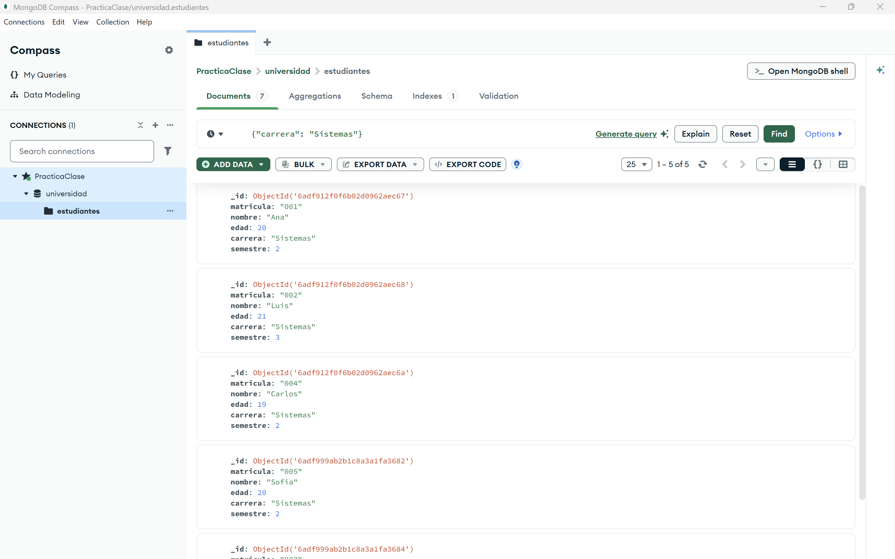

El resultado muestra cinco documentos correspondientes a los estudiantes de Sistemas.

**Ejecución de las consultas en MongoDB Shell:**

Las siguientes capturas documentan las distintas consultas ejecutadas desde Visual Studio Code.

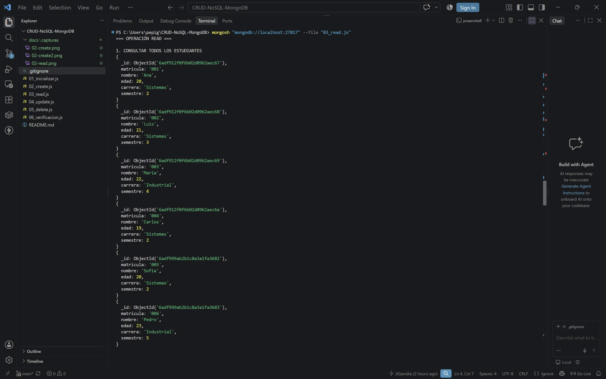

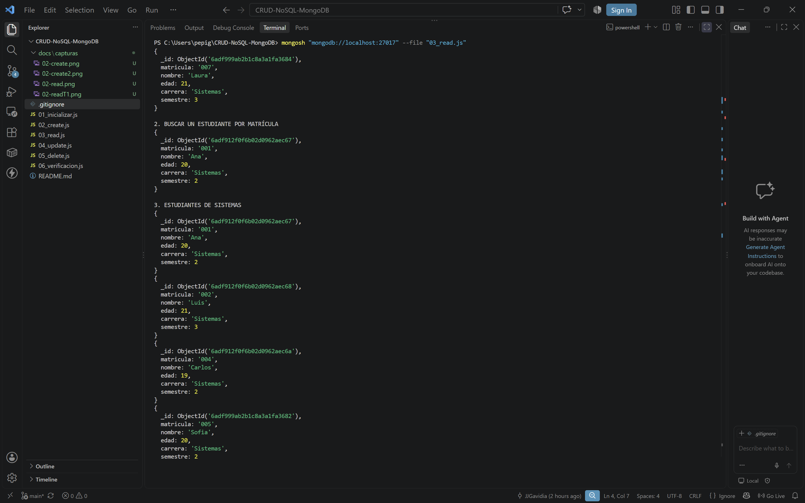

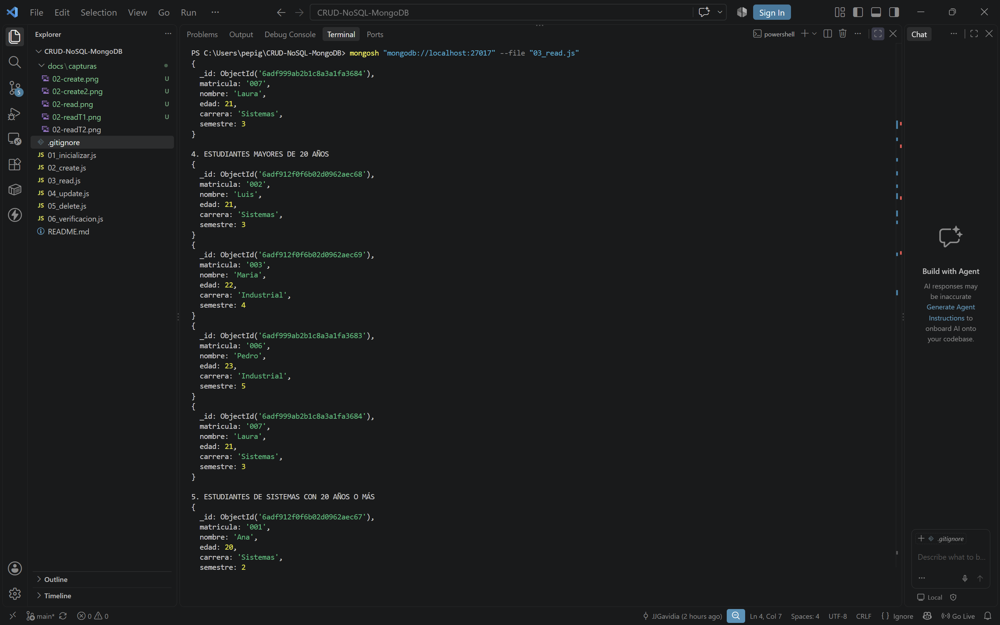

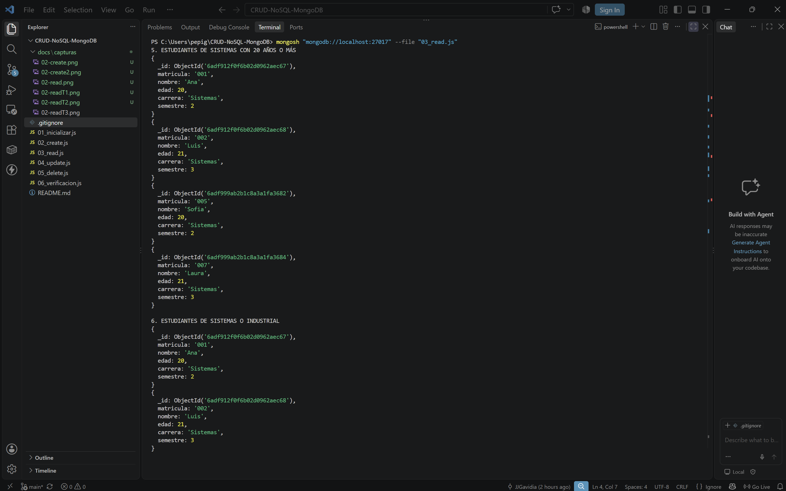

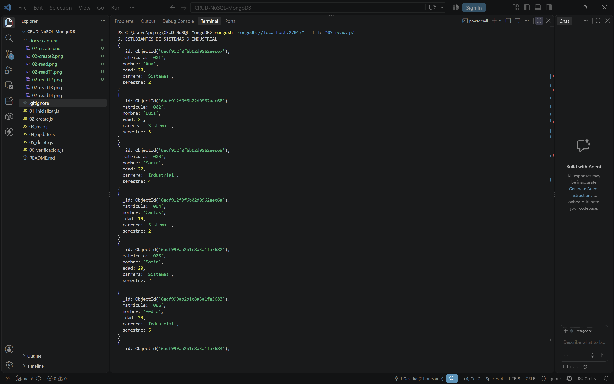

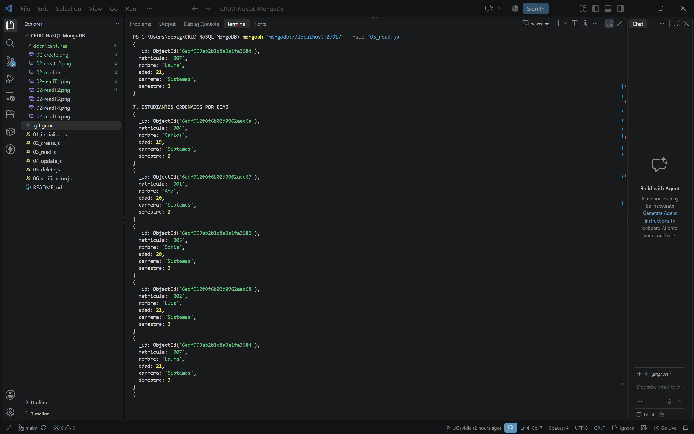

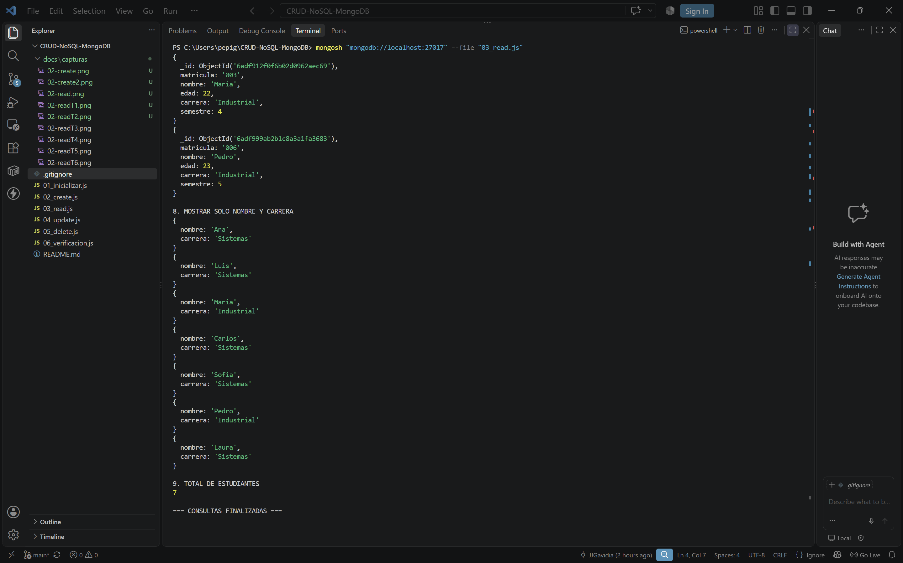

**Resultado:** Las nueve consultas se ejecutaron y la colección conservó sus siete documentos.

---

## 8. UPDATE — Actualización de documentos

**Archivo:** `04_update.js`

UPDATE permite modificar información de documentos que ya existen en MongoDB.

Para esta práctica utilizamos los métodos `updateOne()` y `updateMany()`.

### 8.1. Actualizar un documento con `updateOne()`

```javascript
estudiantes.updateOne(
  { matricula: "001" },
  { $set: { semestre: 3 } }
)
```

Este comando localiza a Ana mediante su matrícula y modifica su semestre de 2 a 3.

El operador `$set` permite establecer un nuevo valor para un campo.

### 8.2. Actualizar varios documentos con `updateMany()`

```javascript
estudiantes.updateMany(
  { carrera: "Sistemas" },
  { $inc: { semestre: 1 } }
)
```

Este comando aumenta en uno el semestre de todos los estudiantes de Sistemas.

El operador `$inc` permite incrementar un campo numérico.

### 8.3. Ejecutar UPDATE

```powershell
mongosh "mongodb://localhost:27017" --file "04_update.js"
```

### 8.4. Resultados esperados

| Estudiante | Semestre inicial | Semestre final |
|---|---|---|
| Ana | 2 | 4 |
| Luis | 3 | 4 |
| Carlos | 2 | 3 |
| Sofia | 2 | 3 |
| Laura | 3 | 4 |

**¿Por qué Ana termina en cuarto semestre?**

Primero `updateOne()` modifica su semestre de 2 a 3. Después `updateMany()` aumenta su semestre nuevamente porque pertenece a la carrera de Sistemas.

### Evidencias de UPDATE

**Antes de ejecutar las actualizaciones:**

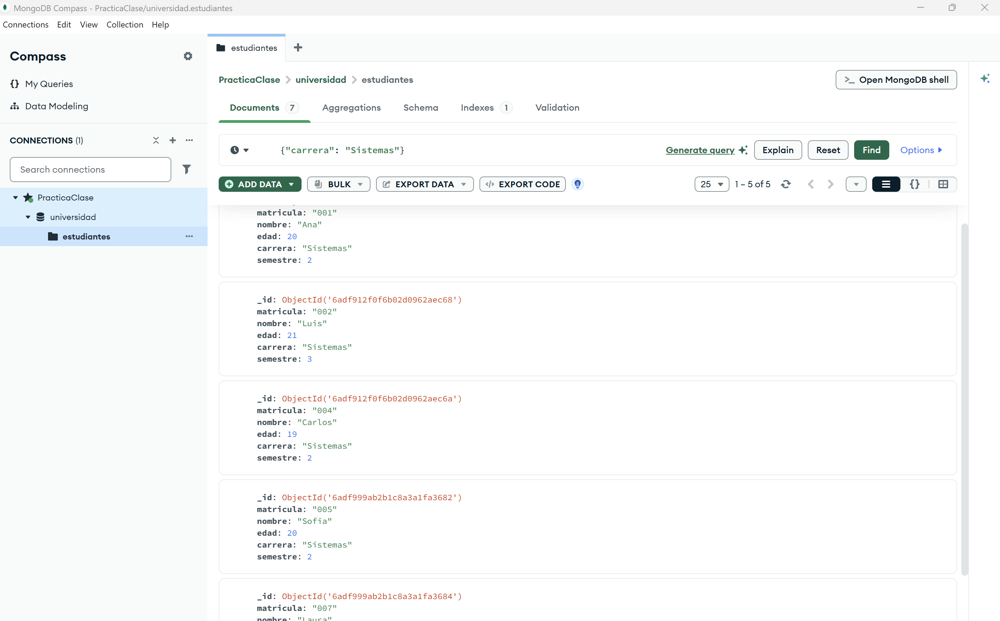

**Después de ejecutar las actualizaciones:**

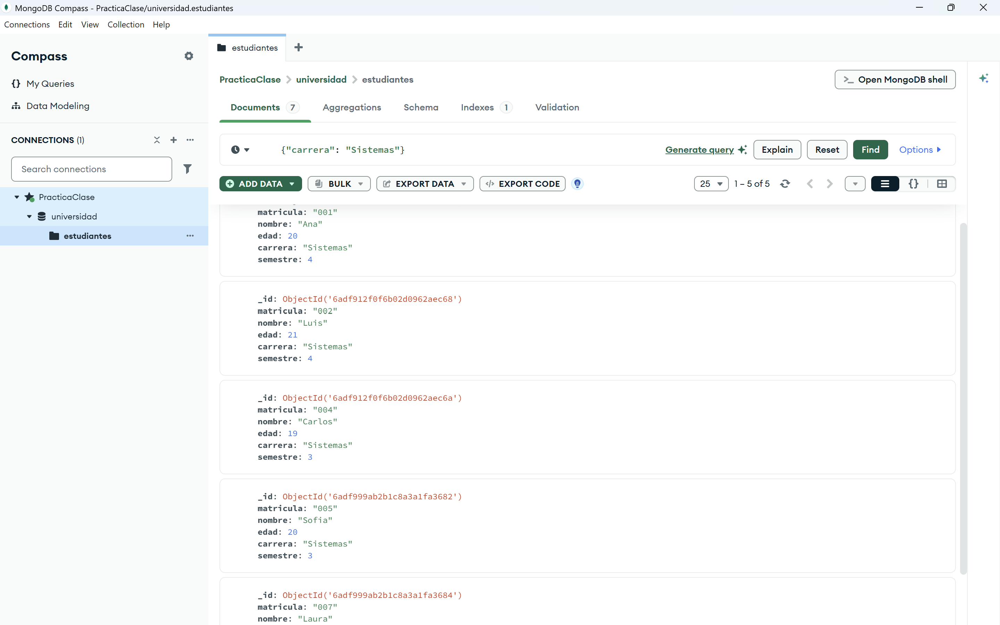

**Resultado:** Se modificaron los semestres de los estudiantes de Sistemas y se conservaron los siete documentos de la colección.

**Nota:** Este script debe ejecutarse una sola vez por demostración, ya que `$inc` aumenta nuevamente los valores cada vez que se ejecuta.

---

## 9. DELETE — Eliminación de documentos

**Archivo:** `05_delete.js`

DELETE permite eliminar documentos de una colección.

MongoDB proporciona métodos para eliminar uno o varios documentos según las condiciones establecidas.

### 9.1. Eliminar un documento con `deleteOne()`

```javascript
estudiantes.deleteOne({
  matricula: "004"
})
```

Este comando elimina al estudiante Carlos mediante su matrícula.

**Resultado esperado:** Un documento eliminado.

### 9.2. Eliminar varios documentos con `deleteMany()`

```javascript
estudiantes.deleteMany({
  carrera: "Industrial"
})
```

Este comando elimina a todos los estudiantes de Industrial.

En nuestro ejemplo se eliminan Maria y Pedro.

**Resultado esperado:** Dos documentos eliminados.

### 9.3. Ejecutar DELETE

```powershell
mongosh "mongodb://localhost:27017" --file "05_delete.js"
```

### 9.4. Resultados esperados

| Operación | Cantidad |
|---|---|
| Documentos antes de eliminar | 7 |
| Eliminados con `deleteOne()` | 1 |
| Eliminados con `deleteMany()` | 2 |
| **Documentos restantes** | **4** |

### Evidencias de DELETE

**Antes de ejecutar las eliminaciones:**

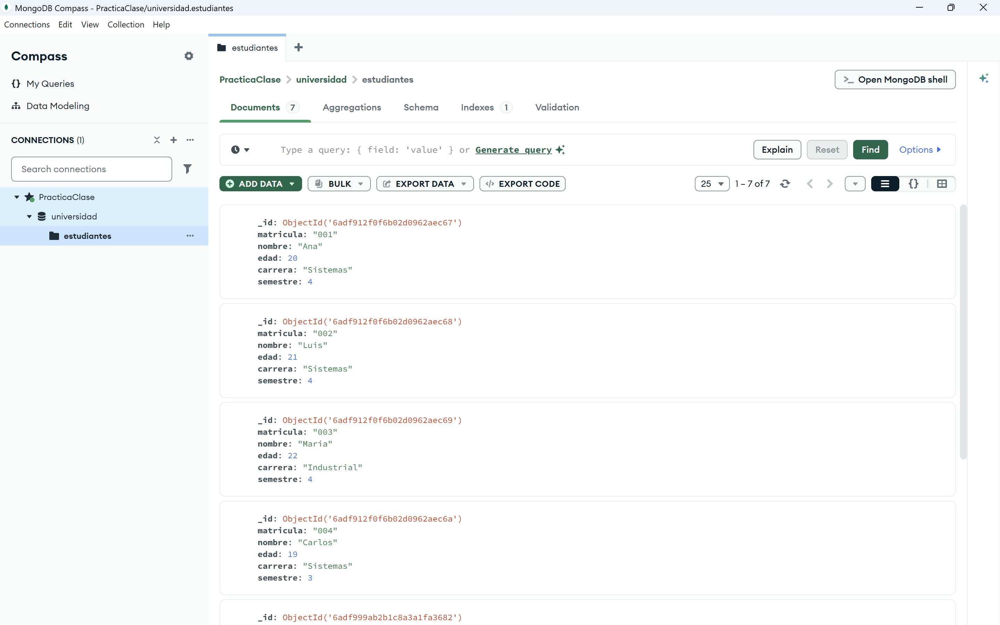

**Resultados obtenidos en la terminal:**

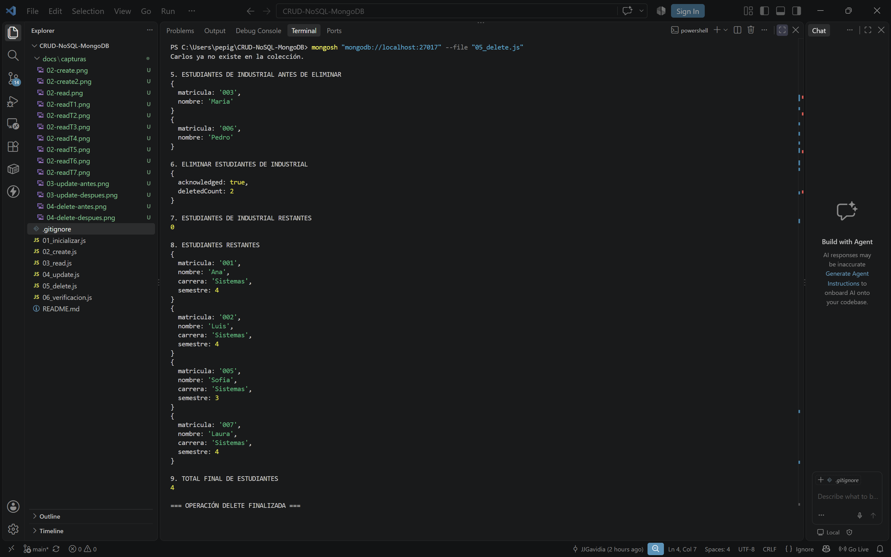

**Después de ejecutar las eliminaciones:**

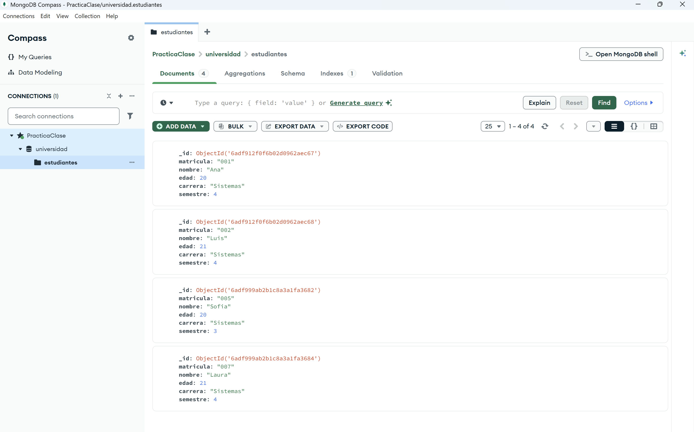

**Resultado:** Se eliminaron correctamente tres estudiantes y quedaron cuatro documentos en la colección.

---

## 10. Verificación automática del CRUD

**Archivo:** `06_verificacion.js`

Además de ejecutar las operaciones CRUD, implementamos un script que comprueba automáticamente los resultados finales.

Este archivo permite validar que los documentos se encuentren en el estado esperado después de ejecutar las operaciones anteriores.

### 10.1. Comprobaciones realizadas

El script verifica:

1. Que existan exactamente cuatro estudiantes.
2. Que Ana tenga el semestre correcto.
3. Que Luis tenga el semestre correcto.
4. Que Sofia tenga el semestre correcto.
5. Que Laura tenga el semestre correcto.
6. Que Carlos haya sido eliminado.
7. Que Maria haya sido eliminada.
8. Que Pedro haya sido eliminado.
9. Que no queden estudiantes de Industrial.

### 10.2. Ejecutar la verificación

```powershell
mongosh "mongodb://localhost:27017" --file "06_verificacion.js"
```

### 10.3. Resultado esperado

```text
=== RESULTADO DE LAS PRUEBAS ===
Pruebas correctas: 9
Pruebas fallidas: 0
RESULTADO FINAL: TODAS LAS PRUEBAS PASARON
```

### Evidencia de la verificación

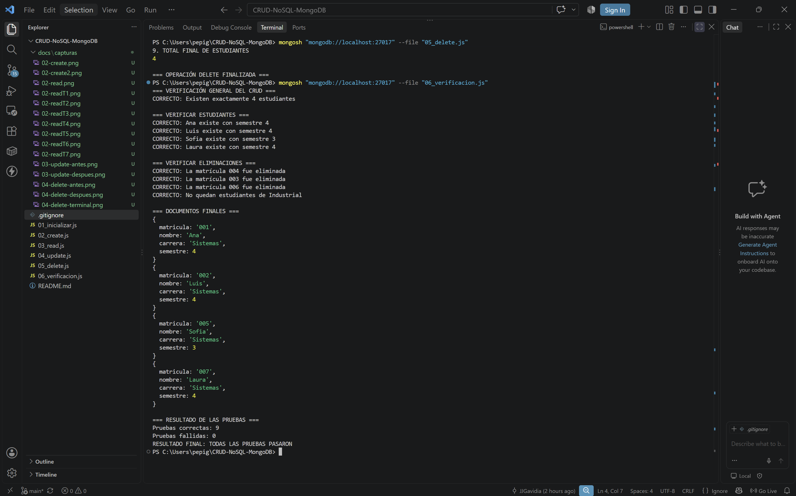

**Resultado:** Las nueve pruebas se completaron correctamente y no se detectaron resultados inesperados.

---

## 11. Resultado final de la base de datos

Después de ejecutar correctamente los seis scripts, la colección `estudiantes` contiene:

| Matrícula | Nombre | Carrera | Semestre |
|---|---|---|---|
| 001 | Ana | Sistemas | 4 |
| 002 | Luis | Sistemas | 4 |
| 005 | Sofia | Sistemas | 3 |
| 007 | Laura | Sistemas | 4 |

**Resumen general:**

| Etapa | Documentos |
|---|---|
| Inicialización | 4 |
| Después de CREATE | 7 |
| Después de READ | 7 |
| Después de UPDATE | 7 |
| Después de DELETE | 4 |
| Después de VERIFICACIÓN | 4 |

READ únicamente consulta información. UPDATE modifica campos de los documentos, pero no cambia su cantidad.

---

## 12. Verificación mediante MongoDB Compass

MongoDB Compass proporciona una interfaz gráfica para explorar las bases de datos y consultar documentos.

Para revisar el proyecto:

1. Abrir MongoDB Compass.
2. Conectar utilizando `mongodb://localhost:27017`.
3. Seleccionar la base de datos `universidad`.
4. Abrir la colección `estudiantes`.
5. Seleccionar la pestaña **Documents**.
6. Utilizar los filtros MQL para consultar información.
7. Presionar **Find** o **Refresh** para comprobar los resultados.

Ejemplo de filtro:

```json
{ "carrera": "Sistemas" }
```

Este filtro muestra únicamente los estudiantes que pertenecen a la carrera de Sistemas.

La cantidad de documentos obtenidos depende de la etapa de la demostración en la que se ejecute la consulta.

---

## 13. Reiniciar la demostración

Para volver a ejecutar el CRUD desde el principio, primero se debe inicializar la colección:

```powershell
mongosh "mongodb://localhost:27017" --file "01_inicializar.js"
```

Después se ejecutan los demás archivos en orden:

```powershell
mongosh "mongodb://localhost:27017" --file "02_create.js"
```

```powershell
mongosh "mongodb://localhost:27017" --file "03_read.js"
```

```powershell
mongosh "mongodb://localhost:27017" --file "04_update.js"
```

```powershell
mongosh "mongodb://localhost:27017" --file "05_delete.js"
```

```powershell
mongosh "mongodb://localhost:27017" --file "06_verificacion.js"
```

**Precauciones:**

- `01_inicializar.js` elimina los documentos existentes en la colección de práctica.
- `02_create.js` puede generar documentos duplicados si se ejecuta repetidamente.
- `04_update.js` incrementa nuevamente los semestres cuando se vuelve a ejecutar.
- `05_delete.js` elimina documentos según los filtros establecidos.
- `03_read.js` y `06_verificacion.js` no modifican los documentos.

Se recomienda utilizar exclusivamente información ficticia durante la demostración.

---

## 14. Conclusiones

Este proyecto demuestra que MongoDB permite administrar información mediante las cuatro operaciones fundamentales CRUD utilizando **MongoDB Query Language (MQL)**.

A través de una colección de estudiantes, fue posible aplicar diferentes métodos para insertar, consultar, actualizar y eliminar documentos.

Además, se utilizaron filtros y operadores para realizar consultas más específicas, demostrando algunas de las posibilidades de MQL.

La combinación de **Visual Studio Code, MongoDB Shell y MongoDB Compass** permitió ejecutar los scripts y comprobar visualmente los cambios en la base de datos.

Finalmente, se implementó un sistema de verificación automática que confirmó el resultado de las operaciones mediante **nueve pruebas correctas y cero fallidas**.

El repositorio incluye el código fuente, las instrucciones y las capturas necesarias para reproducir el ejercicio.

---

## 15. Referencias

- [Documentación oficial de MongoDB](https://www.mongodb.com/docs/manual/)
- [Operaciones CRUD de MongoDB](https://www.mongodb.com/docs/manual/crud/)
- [Documentación de MongoDB Shell](https://www.mongodb.com/docs/mongodb-shell/)
- [Documentación de MongoDB Compass](https://www.mongodb.com/docs/compass/)
- [Visual Studio Code](https://code.visualstudio.com/docs)
- [Documentación de Git](https://git-scm.com/doc)

---

**Proyecto académico — Bases de Datos Avanzadas**

**Tema:** Lenguajes para consultas a bases de datos NoSQL

**Tecnología principal:** MongoDB Query Language (MQL)